# AI Product Manager

A product management command centre built from the master build prompt. It helps a product team move from raw customer feedback to prioritised opportunities, traceable roadmaps, versioned requirements and a permanent decision log. An AI assistant answers questions grounded in the company's own data. The Anthropic API key never leaves the server.

**Live:** https://ai-pm-platform-anjan.netlify.app

---

## Contents

1. [Features and status](#1-features-and-status)
2. [How it works](#2-how-it-works)
3. [Architecture](#3-architecture)
4. [Data model](#4-data-model)
5. [Key flows](#5-key-flows)
6. [Scoring and health](#6-scoring-and-health)
7. [Security](#7-security)
8. [Run locally](#8-run-locally)
9. [Deploy to Netlify](#9-deploy-to-netlify)
10. [Configuration reference](#10-configuration-reference)
11. [Troubleshooting](#11-troubleshooting)
12. [Limitations and roadmap](#12-limitations-and-roadmap)
13. [Project layout](#13-project-layout)

---

## 1. Features and status

| Module | Status | What it does |
|---|---|---|
| Overview | Working | Product health score with its formula shown, top opportunities by RICE, and rule-based recommendations. |
| AI Product Manager | Working | Chat grounded in your company context. Labels claims as verified, hypothesis, assumption or recommendation. |
| Company Intelligence | Working | Company profile, strategic objectives, and labelled knowledge items. Verified items need a source. Items older than 180 days are flagged. |
| Customer Insights | Working | AI extracts customer problems from pasted feedback. Only quotes found verbatim in the input are kept. Human review is required before a problem counts toward scores. |
| Opportunities | Working | Backlog with status tracking. Prioritise tab with RICE and ICE scoring and overrides that always carry a rationale. |
| Product Strategy | Working | Permanent decision log with context, alternatives, trade-offs, owner and later outcome. |
| Roadmaps | Working | Now / Next / Later. Every item must link to a problem or opportunity, an objective and a measurable metric. |
| PRDs & Documentation | Working | 15-section PRD template, AI drafts (never saved until you save), version history with a line diff, review and approval. |
| Settings | Working | AI connection status, access token, JSON export and import, clear data. |
| Market Research, Design, Engineering, Analytics, Experiments, Finance, Reports, Integrations, Agent Management | Scaffold | Each page states what the spec requires and what is needed to build it. No fake data, no fake connections. |

---

## 2. How it works

The product follows the lifecycle from the master prompt: **Research → Discovery → Strategy → Prioritisation → Planning → Documentation → Measurement → Learning**. Each module feeds the next.

```mermaid
flowchart LR
    A["Customer feedback<br/>interviews, tickets, reviews"] -->|AI extracts,<br/>human reviews| B["Customer problems"]
    C["Company profile and<br/>knowledge items"] --> D
    B --> E["Opportunities<br/>backlog"]
    E -->|RICE / ICE<br/>and overrides| F["Prioritised list"]
    F --> G["Roadmap<br/>Now / Next / Later"]
    G --> H["PRDs<br/>draft, review, approve"]
    H --> I["Decision log"]
    I -->|outcome recorded<br/>after 30 days| J["Health score<br/>and recommendations"]
    J -.->|feeds back| C

    D["AI Product Manager<br/>grounded in all of the above"]
    B -.-> D
    E -.-> D
    G -.-> D

    classDef ai fill:#e7ecff,stroke:#3b5bdb,color:#1b2230
    classDef store fill:#f0f2f5,stroke:#5d6676,color:#1b2230
    class D,B ai
    class A,C,E,F,G,H,I,J store
```

Blue nodes involve AI. Everything else is stored as your own data or computed from it.

---

## 3. Architecture

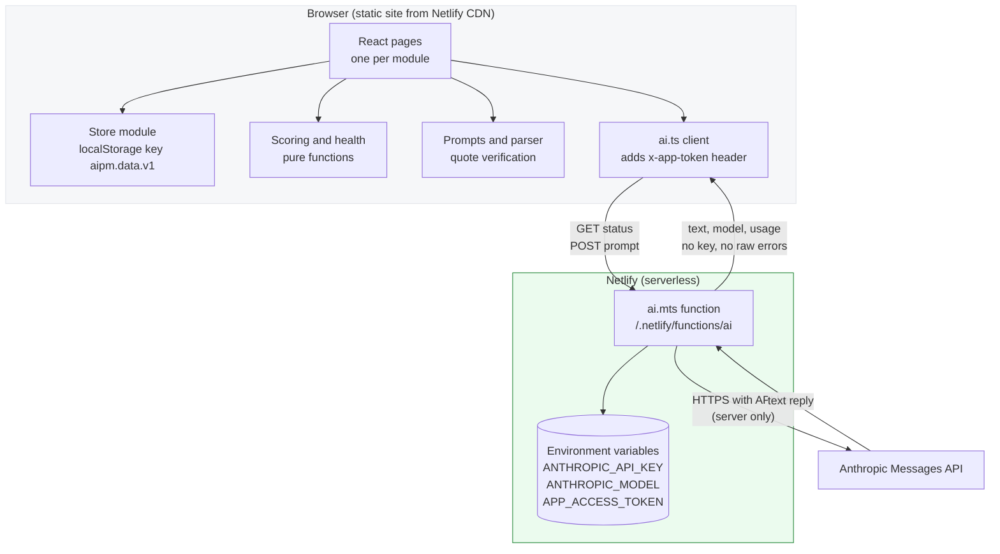

**Why this shape:**
- The API key lives only in Netlify's environment, so it is never bundled into the browser code.
- The function validates every request and enforces size limits before calling the paid API.
- The browser holds all product data for now. That keeps the first deployment simple, and the store module is the single place to swap in a database later.

---

## 4. Data model

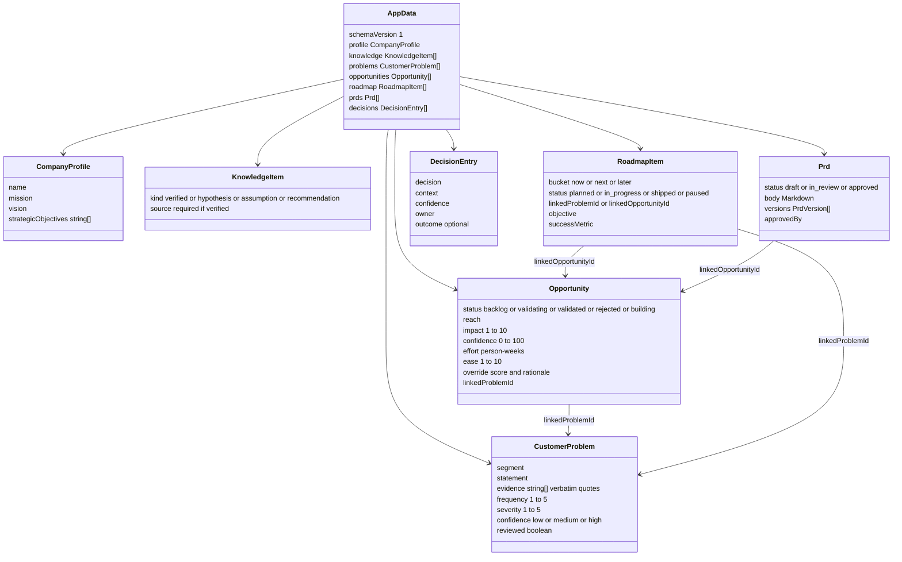

---

## 5. Key flows

### 5.1 Asking the AI Product Manager

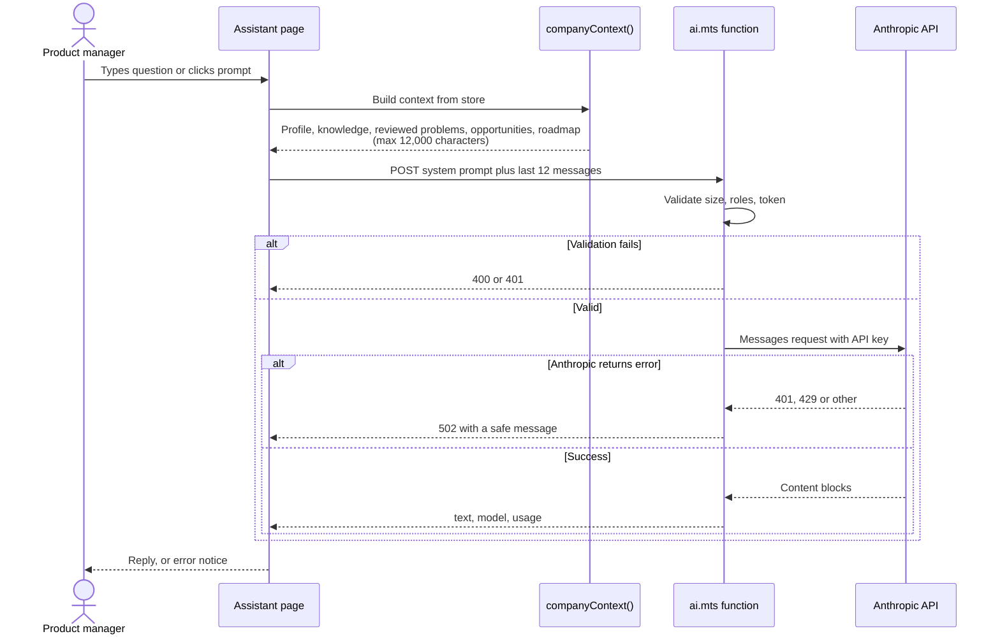

### 5.2 Turning feedback into problems

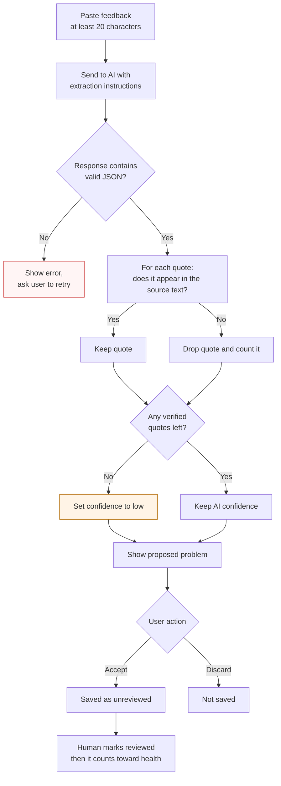

The quote check exists so that a model cannot invent evidence and have it appear as customer data.

### 5.3 Roadmap item rules

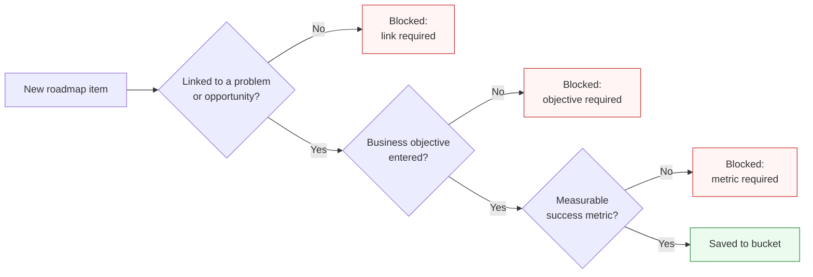

### 5.4 PRD lifecycle

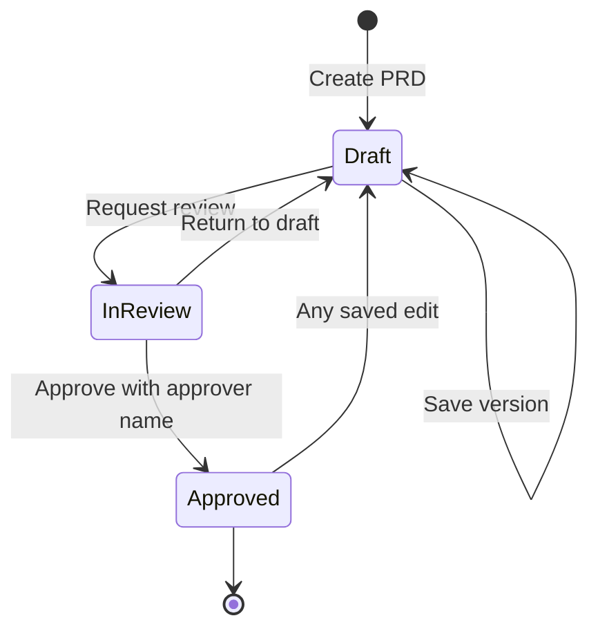

Editing an approved PRD returns it to draft, so the change has to be approved again.

### 5.5 Deploying

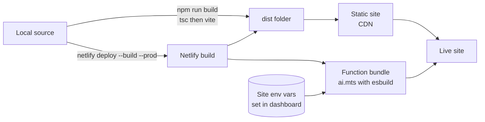

Environment variables are read when the function runs. After you change one, redeploy to be sure the new value is in use.

---

## 6. Scoring and health

### RICE and ICE

```
RICE = (Reach × Impact × Confidence %) ÷ Effort       effort must be greater than 0
ICE  = Impact × (Confidence % ÷ 10) × Ease
```

If effort is 0, RICE returns no score rather than an invented number. A strategic override replaces the computed score, is flagged as overridden, and must carry a rationale.

### Product health score

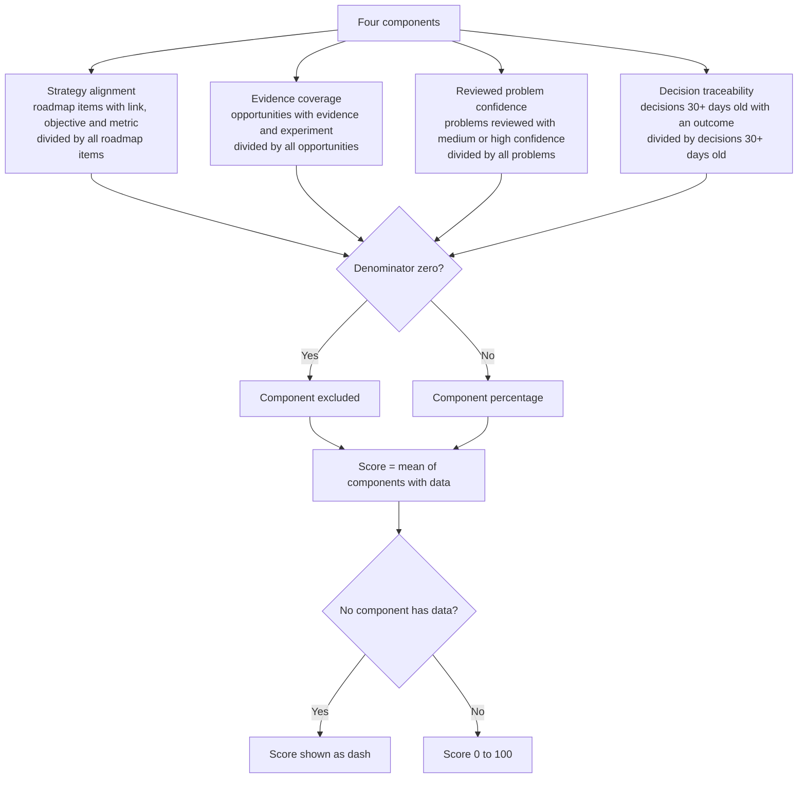

Components with no data are excluded rather than counted as zero, so a new workspace isn't penalised for missing history.

---

## 7. Security

| Control | Where | What it prevents |
|---|---|---|
| API key stored only in Netlify environment | Netlify dashboard | Key leaking to browser or repository |
| Server-side proxy | `netlify/functions/ai.mts` | Browser calling the paid API directly |
| Input limits: 20,000 characters for the system prompt, 30,000 per message, 40 messages, output capped at 4,000 tokens | Function | Runaway cost and oversized payloads |
| Optional `APP_ACCESS_TOKEN` checked on every AI request | Function | Strangers using your API credits |
| Upstream error details logged by status code only | Function | Leaking keys or user data into logs |
| 60-second upstream timeout | Function | Hung requests |
| Strict Content-Security-Policy, frame denial, nosniff | `netlify.toml` | Injected scripts and clickjacking |
| Quote verification for extracted evidence | `prompts.ts` | Invented customer quotes |
| Assistant governance prompt | `prompts.ts` | Invented facts, causal claims from correlation |

**Important:** the access token is a shared secret, not user login. Anyone who has it can use the AI features. For a private deployment, also turn on Netlify site protection, or add Netlify Identity.

---

## 8. Run locally

```bash
npm install
npm test             # 13 unit tests: scoring, health, quote verification
npm run build        # typecheck, then production build into dist/
npm run dev          # UI only on http://localhost:5173
```

To test AI features on your machine:

```bash
npm i -g netlify-cli
cp .env.example .env         # then set ANTHROPIC_API_KEY inside it
netlify dev                  # serves the UI and the function together
```

On Windows, if PowerShell reports that scripts are disabled, use Command Prompt (`cmd`) for `npm` and `npx` commands.

---

## 9. Deploy to Netlify

### Option A: command line (what was used for the first deploy)

```bash
npm install
npx netlify-cli login
npx netlify-cli deploy --build --prod
```

The first deploy asks you to choose a team and to create a new site. Choose your personal team and pick a unique site name.

### Option B: Git-connected site (continuous deploys)

1. Push the project to a Git repository.
2. In Netlify, choose **Add new site → Import an existing project** and select the repository. `netlify.toml` supplies the build settings.
3. Add the environment variables (section 10).
4. Trigger a deploy.

### After any deploy

1. Open **Settings** in the app and confirm **AI connection** shows as connected.
2. If you set `APP_ACCESS_TOKEN`, enter the same value under **Access token**.
3. Ask the assistant one question to confirm it answers.

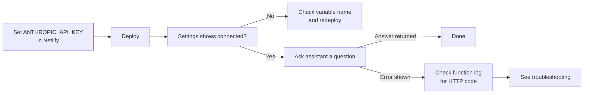

---

## 10. Configuration reference

| Variable | Required | Default | Purpose |
|---|---|---|---|
| `ANTHROPIC_API_KEY` | For AI features | none | Authenticates with the Anthropic API. Keep it secret. |
| `ANTHROPIC_MODEL` | No | `claude-sonnet-5-5` | Model used for all AI calls. Use `claude-haiku-5-5` for a faster, cheaper option. |
| `APP_ACCESS_TOKEN` | No, recommended if public | none | Shared secret. When set, AI requests without it are rejected with 401. |

These are set in **Site configuration → Environment variables** on the Netlify dashboard, not in a file in the repository.

---

## 11. Troubleshooting

Find the HTTP code in the function log at `https://app.netlify.com/projects/<site-name>/logs/functions`.

| Symptom | Likely cause | Fix |
|---|---|---|
| Settings says "not configured" | `ANTHROPIC_API_KEY` missing or the site wasn't redeployed | Add the variable, then redeploy |
| "The AI provider returned an error" and log shows **401** | Key is wrong, revoked, or has extra spaces | Create a new key, re-paste it, redeploy |
| Log shows **400** or **404** | Model not available to your key | Set `ANTHROPIC_MODEL=claude-haiku-5-5`, redeploy |
| Log shows **402** or **403** | No credits, or billing not enabled | Check billing in the Anthropic console |
| "AI rate limit reached" | Too many requests in a short time | Wait a minute and retry |
| "Access token rejected" | Token in Settings does not match `APP_ACCESS_TOKEN` | Enter the exact value |
| "Model did not contain JSON" during extraction | Feedback too short or unclear | Paste more text, then retry |
| Data disappeared | Browser storage cleared, or a different browser or device | Restore from a Settings export |
| Local build says `tsc` not recognised | `npm install` did not finish | Run `npm install` again in Command Prompt |

---

## 12. Limitations and roadmap

**Current limitations**
- Data lives in the browser. Clearing site data or switching devices loses it unless you export. Export regularly from Settings.
- Access control is a shared token, not user accounts.
- RICE and ICE are only as good as their inputs. Overrides are flagged, not prevented.
- AI output is a draft, not a decision. Verify before acting.
- Market research, design, engineering, analytics, experiments, finance, reports, integrations and agent management are scaffolds.

**Planned, in the order the spec recommends**

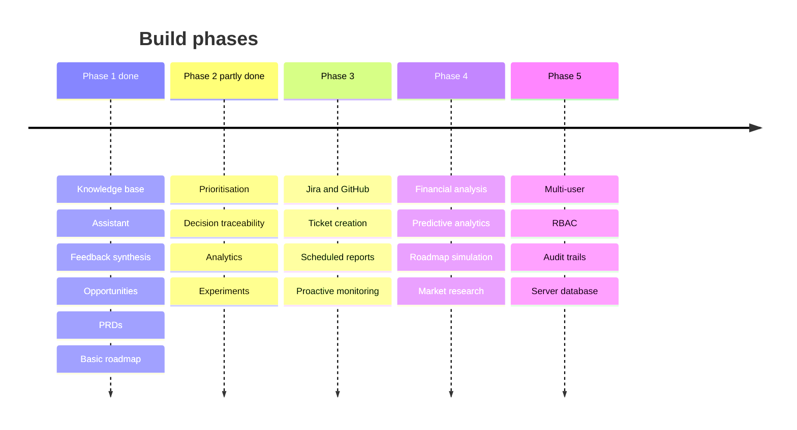

The biggest next step is a server database with user accounts. Without it, the app cannot safely serve a team.

---

## 13. Project layout

```
ai-pm-platform/
├── netlify/
│   └── functions/
│       └── ai.mts                 server-side AI proxy
├── netlify.toml                   build settings, security headers, SPA fallback
├── index.html
├── vite.config.ts
├── tsconfig.json
├── package.json
├── .env.example                   template only, never commit real keys
├── src/
│   ├── main.tsx                   app entry, router, store provider
│   ├── App.tsx                    navigation and routes
│   ├── styles.css
│   ├── components/
│   │   └── ui.tsx                 shared buttons, cards, badges, notices
│   ├── lib/
│   │   ├── types.ts               domain model
│   │   ├── store.tsx              persisted state, import and export
│   │   ├── scoring.ts             RICE, ICE, overrides, health score
│   │   ├── scoring.test.ts
│   │   ├── prompts.ts             governance prompt, context builder, quote-verified parser
│   │   ├── prompts.test.ts
│   │   └── ai.ts                  browser client for the function
│   └── pages/
│       ├── Overview.tsx           health score and recommendations
│       ├── Assistant.tsx          AI Product Manager chat
│       ├── CompanyIntel.tsx       profile and knowledge items
│       ├── CustomerInsights.tsx   feedback to problems
│       ├── Opportunities.tsx      backlog and prioritisation
│       ├── Roadmaps.tsx           Now, Next, Later
│       ├── Prds.tsx               PRD editor, versions, approval
│       ├── Strategy.tsx           decision log
│       ├── Settings.tsx           AI status, token, data
│       └── Scaffold.tsx           modules not yet built
└── README.md
```
